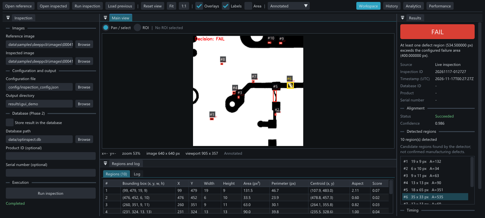
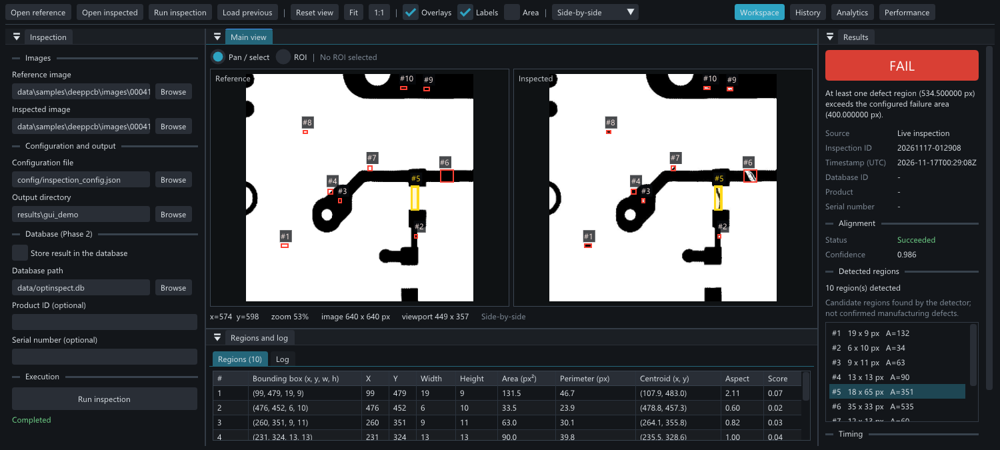
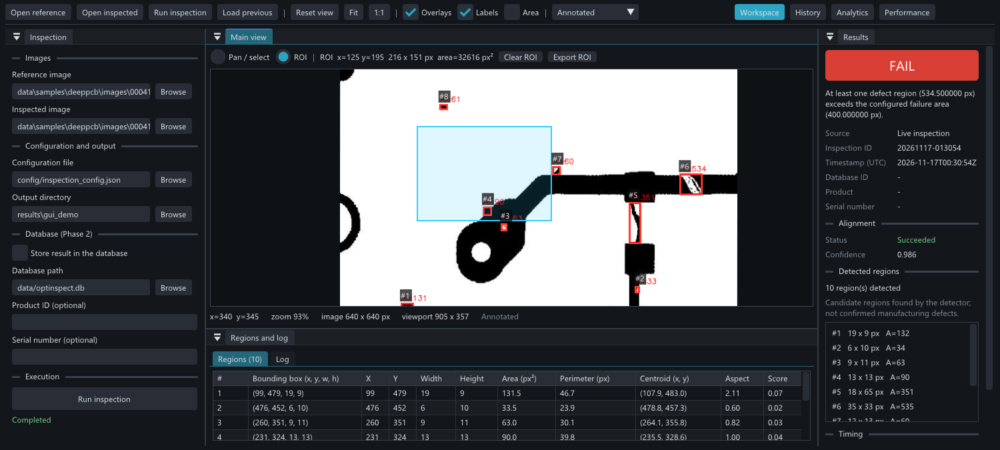
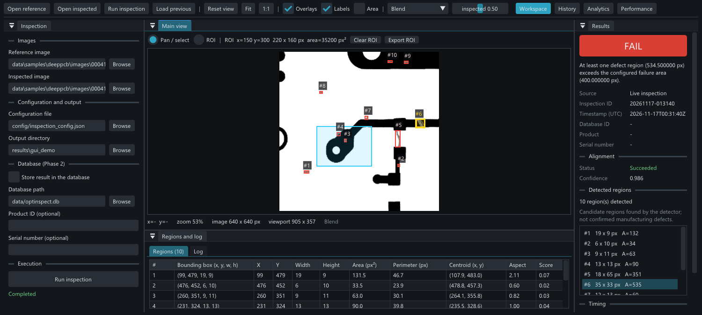
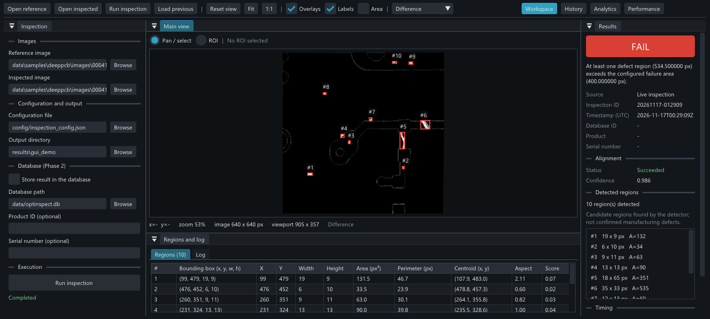
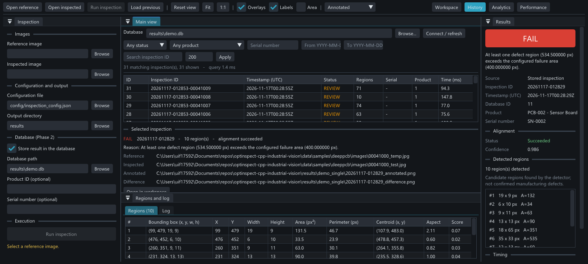
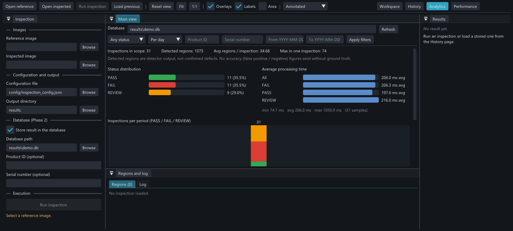

# OptiInspect

**OptiInspect** is a C++17 industrial optical inspection engine for printed
circuit boards (PCBs), built on traditional (non-machine-learning) OpenCV
computer vision techniques. Given a defect-free reference image and an
inspected image of the same board, it aligns the two, computes a pixel
difference, segments candidate defect regions, measures their geometry, and
produces a PASS / FAIL / REVIEW decision with a structured JSON report and
annotated output images.

**Phase 1** is the standalone inspection engine and CLI. **Phase 2** adds an
optional SQLite persistence layer (inspection history, defect measurements,
image/report traceability) and SQL-based quality analytics, without changing
the detection algorithms. Machine-learning classification, an external
communication protocol are explicitly reserved for a future phase (see
[Scope](#scope-and-known-limitations) below). **Phase 3** adds an interactive OpenGL desktop
application (`optinspect_gui`) with image visualization, defect overlays, ROI selection,
inspection history and quality analytics - see [Phase 3](#phase-3-visualization--optimization).

## Roadmap

| Phase | Scope | Status |
|---|---|---|
| 1 | Traditional-CV inspection engine, CLI, reports, tests | Implemented and verified locally (VS2017). |
| 2 | SQLite persistence, CRUD, history queries, quality analytics, CLI commands, tests, benchmark | Implemented and verified locally (all 158 tests pass, see [Phase 2](#phase-2-database--quality-analytics)); the GitHub Actions workflow was extended but **has not been run yet**. |
| 3 | OpenGL desktop GUI: image viewer, overlays, ROI, inspection from the GUI, history, analytics, performance measurements | Implemented and verified locally with a software OpenGL driver (272 tests pass, 10 of them OpenGL smoke tests; no GPU was available, see [Phase 3](#phase-3-visualization--optimization)); the GitHub Actions `build-gui` job **has not been run yet**. |

## Features

- **Image alignment**: dense (ECC, intensity-based) or sparse (ORB
  feature-based + homography) registration of the inspected image to the
  reference, with explicit failure/low-confidence detection rather than
  silently proceeding on bad alignment.
- **Difference-based defect candidate detection**: grayscale conversion,
  Gaussian blur, absolute difference, configurable thresholding (fixed /
  Otsu / adaptive mean / adaptive Gaussian), and morphological cleanup
  (open/close) to segment candidate defect regions via contour analysis.
- **Geometric defect measurement**: bounding box, area, centroid, perimeter,
  aspect ratio, and a rule-based (non-semantic) confidence score per region.
- **Configurable decision logic**: PASS / FAIL / REVIEW based on defect
  count, defect area, and alignment confidence thresholds, fully separated
  from image-processing code.
- **Structured JSON reporting** and **annotated image output** for every
  inspection run.
- **Extensible detector interface** (`IDefectDetector`) so a future
  ML-based detector could be substituted without changing the pipeline.
- **Inspection database (Phase 2)**: SQLite persistence of every inspection,
  its defect measurements and its image/report paths, with CRUD commands,
  history queries and SQL quality analytics.
- **Desktop application (Phase 3)**: OpenGL 3.3 / Dear ImGui workstation to run
  inspections, compare images, inspect defect regions, browse the history and view analytics.

## Repository layout

```
include/            Public headers, grouped by module (acquisition,
                     processing, detection, database, common, communication*)
src/                 Implementation, plus the application layer (CLI,
                     pipeline orchestration, reporting, annotation,
                     database commands), src/database/ (SQLite layer),
                     src/visualization/ (OpenGL components) and
                     src/application/gui/ (the desktop application)
tests/               GoogleTest unit, integration, database and
                     visualization tests + synthetic image test support
resources/shaders/   GLSL shaders of the GUI
config/              Default JSON configuration files
data/                Sample images (small curated DeepPCB subset) and
                     reference-image storage location
scripts/             Python helper scripts (dataset prep, report summary)
docs/                Architecture, algorithm, dataset, database and performance docs
vcpkg/               vcpkg (cloned locally; not committed) used to obtain
                     OpenCV, GoogleTest and SQLite
.github/workflows/   CI configuration

* communication/ is a reserved, empty-of-logic module for a future phase; see its
  README.md. visualization/ is implemented in Phase 3.
```

## Building

### Prerequisites

- Windows PowerShell, Git, and CMake >= 3.16 available in `PATH`
- Visual Studio 2022 or Visual Studio 2022 Build Tools with the **Desktop
  development with C++** workload (MSVC v143 / x64 and a Windows SDK)

The commands below assume PowerShell is open in the repository root and that
the old `vcpkg/` and `build/` folders have been removed. The configure command
creates `build/` with the Visual Studio generator; keep that folder name.

### 1. Clone and bootstrap vcpkg

```powershell
git clone https://github.com/microsoft/vcpkg .\vcpkg
.\vcpkg\bootstrap-vcpkg.bat
```

### 2. Install the dependencies

```powershell
# This project uses traditional CV only, so install the OpenCV features it needs:
.\vcpkg\vcpkg.exe install "opencv4[core,highgui,calib3d,png,jpeg]:x64-windows"
.\vcpkg\vcpkg.exe install "gtest:x64-windows"
# SQLite for the Phase 2 database layer (linked as a library; the sqlite3
# command-line tool is NOT required):
.\vcpkg\vcpkg.exe install "sqlite3:x64-windows"
# Phase 3 GUI (optional; skip these and configure with -DOPTINSPECT_BUILD_GUI=OFF
# to build only the CLI and the Phase 1/2 tests):
.\vcpkg\vcpkg.exe install "glfw3:x64-windows"
.\vcpkg\vcpkg.exe install "glad[gl-api-33,loader]:x64-windows"
.\vcpkg\vcpkg.exe install "imgui[glfw-binding,opengl3-binding,docking-experimental]:x64-windows"
```

### 3. Configure the project

Use the Visual Studio 2022 generator below when Visual Studio 2022 or its
Build Tools are installed. If a previous configure attempt created `build/`
with a different generator, remove that incomplete build directory first.
CMake will recreate it with the same `build` name:

```powershell
if (Test-Path .\build) { Remove-Item -Recurse -Force .\build }
```

```powershell
cmake -S . -B build -G "Visual Studio 17 2022" -A x64 -DCMAKE_TOOLCHAIN_FILE="vcpkg/scripts/buildsystems/vcpkg.cmake" -DVCPKG_TARGET_TRIPLET=x64-windows
```

This command uses the Visual Studio 2022 x64 generator and the vcpkg toolchain.
CMake cannot change the generator in an existing build directory. The GUI is
enabled by default (`-DOPTINSPECT_BUILD_GUI=ON`); add `-DOPTINSPECT_BUILD_GUI=OFF`
to skip it and its dependencies.

### 4. Build the CLI

```powershell
cmake --build build --config Release --target optinspect
```

The CLI executable will be at
`.\build\bin\Release\optinspect.exe`. To build all targets, including tests
and the database benchmark, use this instead:

```powershell
cmake --build build --config Release
```

### 5. Run the tests (optional)

```powershell
Push-Location .\build
ctest -C Release --output-on-failure
Pop-Location
```

`-C Release` is required with the Visual Studio generator because it is
multi-config. Running `ctest` from inside `build/` avoids the
`--test-dir` option, which requires CMake >= 3.20.

To run a subset: `ctest -C Release -R BatchDiscovery` (name filter), or run
`build\bin\Release\optinspect_unit_tests.exe`,
`optinspect_integration_tests.exe` or `optinspect_database_tests.exe` directly.

As of this writing, all 158 Phase 1/2 tests pass on this environment (VS2017 / OpenCV
4.14.0 / SQLite 3.54.1, all via vcpkg): the 53 Phase 1 tests (unchanged and
still passing), plus 105 added in Phase 2 (75 database tests, 21 persistence
and CLI integration tests, 9 configuration/CLI-argument unit tests). With the GUI
enabled, 114 Phase 3 tests are added (272 in total, see [Phase 3](#phase-3-visualization--optimization)).

## Usage

```powershell
.\build\bin\Release\optinspect.exe `
    --reference <path-to-golden-image> `
    --input <path-to-inspected-image> `
    --config config\inspection_config.json `
    --output results\
```

Exit codes: `0` = PASS, `1` = FAIL, `2` = REVIEW (alignment or confidence too
low to trust the result), `64`/`70` = usage/runtime errors, `74` = the
inspection ran but storing it in the database failed (Phase 2).

### Decision rules (PASS / FAIL / REVIEW)

The decision is made by `InspectionDecider` from the `decision` section of the
config. Rules are checked **in this order; the first one that applies
decides**:

| # | Rule | Default | Result |
|---|---|---|---|
| 1 | Alignment failed, or alignment confidence `< min_alignment_confidence` | `0.5` | **REVIEW** |
| 2 | **Area rule:** any detected region has `area_px >= fail_area_px` | `400` px | **FAIL** |
| 3 | **Count rule:** number of detected regions `>= fail_defect_count_threshold` | `1` | **FAIL** |
| 4 | None of the above | | **PASS** |

`area_px` is the region's contour area, the `A=<number>` printed next to each
box in the annotated image. Only regions between `detection.min_defect_area_px`
(20) and `detection.max_defect_area_px` (50000) are counted at all. With the
defaults, the count rule makes *any* surviving region a FAIL; the area rule only
determines which reason is reported when a region is large. Raise
`fail_defect_count_threshold` to tolerate small regions, in which case only
regions meeting the area rule (or enough small ones) fail the board. See
[docs/algorithms.md](docs/algorithms.md#7-decision-logic-inspectiondecider).

Each run produces, in the output directory:
- `<id>_report.json` — structured inspection report (see
  [docs/algorithms.md](docs/algorithms.md) for schema details)
- `<id>_annotated.png` — inspected image with defect bounding boxes drawn
- `<id>_difference.png` — the aligned difference image used for detection
- `<id>_performance_report.md` — Markdown report: decision rules applied,
  per-stage timings, and how many detected regions meet / do not meet the area
  rule (batch runs add per-pair rows and min/median/mean/max)

### Batch mode (folders)

Pass directories to `--reference` and `--input` to inspect every
`<id>_temp.*` / `<id>_test.*` pair (DeepPCB naming) in one run:

```powershell
.\build\bin\Release\optinspect.exe `
    --reference data\samples\deeppcb\images --input data\samples\deeppcb\images `
    --config config\inspection_config.json --output results\batch
```

A summary table is printed; exit code is `70` if any pair errored, else `1` if
any FAILed, else `2` if any needs REVIEW, else `0`. Details in
[docs/dataset.md](docs/dataset.md).

### Trying it against real PCB images

A small curated sample of the public DeepPCB dataset is included under
`data/samples/deeppcb/` — see [docs/dataset.md](docs/dataset.md) for
provenance, license notes, and example commands.

```powershell
.\build\bin\Release\optinspect.exe `
    --reference data\samples\deeppcb\images\00041000_temp.jpg `
    --input data\samples\deeppcb\images\00041000_test.jpg `
    --config config\inspection_config.json --output results\
```

## Phase 2: Database & Quality Analytics

Phase 2 stores inspections in an embedded **SQLite** database through the C API
(RAII wrappers for connections, prepared statements and transactions; no ORM).
The database layer does not depend on OpenCV or the detection engine, and the
Phase 1 workflow is unchanged unless you ask for persistence. Design, schema,
ER diagram, deletion policy and migrations: [docs/database-design.md](docs/database-design.md).

### Initialize and configure

```powershell
$exe = ".\build\bin\Release\optinspect.exe"
& $exe db init --database data\optinspect.db     # creates folder, file, schema (safe to repeat)
& $exe db info --database data\optinspect.db     # schema version, journal mode, row counts
```

`db init` never overwrites or drops data: running it on an existing, current
database changes nothing, and it refuses a database that already contains
foreign tables. Persistence can be switched on per run with `--database <path>`
or permanently in `config/inspection_config.json`:

```json
"database": { "enabled": false, "path": "data/optinspect.db", "auto_initialize": true }
```

`--no-database` disables it for one run. Runtime databases (`*.db`, `-wal`,
`-shm`, `-journal`) are git-ignored; keep them outside source directories.

### Products and inspections

```powershell
& $exe product create --database data\optinspect.db --code PCB-001 --name "Controller Board" --revision A
& $exe product list   --database data\optinspect.db
& $exe product show   --database data\optinspect.db --id 1
& $exe product update --database data\optinspect.db --id 1 --revision B
& $exe product delete --database data\optinspect.db --id 1      # refused while inspections reference it

# Inspect and persist (the explicit "inspect" word is optional)
& $exe inspect --reference data\samples\deeppcb\images\00041000_temp.jpg `
               --input data\samples\deeppcb\images\00041000_test.jpg `
               --database data\optinspect.db --product-id 1 --serial SN-0001
```

The run prints the usual summary followed by `Database ID : <n>` and exits with
the decision code (0/1/2). Batch mode (`--reference <dir> --input <dir>`)
persists every pair in its own transaction and adds a `DB id` column.
Everything of one inspection (header row, defects, image references,
configuration snapshot) is written in a single transaction, so it is stored
completely or not at all.

If the database cannot be written, the decision is still printed, all output
files are kept, the exit code is `74`, and the exact retry command is shown:
`optinspect inspection import --report <report.json> --database <path>`.

### CRUD, history and defects

| Entity | Commands |
|---|---|
| Products | `product create / list / show / update / delete` |
| Inspections | `inspection list / show / update / delete / import` (`update` changes only product, serial number, notes and report path; the decision and measurements are immutable) |
| Defects | `defect list` (filter by inspection, area, score) / `defect note` / `defect delete` |
| Images | stored with each inspection (`inspection show` lists them); repository API supports create/read/update/delete of references. Deleting a reference never deletes the file |

```powershell
& $exe inspection list --database data\optinspect.db --status FAIL --from 2026-11-01 --to 2026-11-15
& $exe inspection list --database data\optinspect.db --serial SN-0001 --format json
& $exe inspection show --database data\optinspect.db --id 12
& $exe defect list     --database data\optinspect.db --inspection-id 12 --min-area 100
```

`--to` with a bare date includes that whole day; timestamps are stored in UTC.
Run `optinspect product --help` (or any group name) for the full option list.

### Analytics

```powershell
& $exe analytics summary     --database data\optinspect.db   # PASS/FAIL/REVIEW counts and rates
& $exe analytics defects     --database data\optinspect.db   # totals, average/max per inspection, average area
& $exe analytics products    --database data\optinspect.db   # failure rate and average time per product
& $exe analytics performance --database data\optinspect.db   # avg/min/max time, by status and by product
& $exe analytics trend       --database data\optinspect.db --period week   # per day/week/month with window functions
```

All accept `--product-id`, `--serial`, `--status`, `--from`, `--to` and
`--format table|json`. Rates divide by all inspections in scope and are 0 for an
empty set. Example output for the 10 bundled DeepPCB pairs (stored by one batch
run with the default configuration):

```
Inspection summary (all inspections)
Status  Count  Rate
PASS    0      0.0%
FAIL    10     100.0%
REVIEW  0      0.0%
```

The example is a real run, but it only reflects what the Phase 1 rules decided:
nothing here says whether the detected regions are true defects. The analytics
describe detector output, not detector accuracy (no ground-truth comparison is
performed). Example of the SQL behind `analytics products`:

```sql
SELECT COALESCE(p.product_code, '(unassigned)') AS product, COUNT(*) AS total,
       SUM(i.status = 'FAIL') AS failed,
       1.0 * SUM(i.status = 'FAIL') / COUNT(*) AS failure_rate,
       AVG(i.processing_time_ms) AS avg_ms
FROM inspections i LEFT JOIN products p ON p.product_id = i.product_id
GROUP BY i.product_id HAVING COUNT(*) >= 5
ORDER BY failure_rate DESC, total DESC;
```

More queries (CTE + window functions, traceability) are in
[docs/database-design.md](docs/database-design.md#example-queries).

### Database build and test notes

The database tests use only temporary databases created in the system temp
folder and deleted afterwards; they never touch `data/optinspect.db`.

```powershell
build\bin\Release\optinspect_database_tests.exe          # 75 database unit tests
build\bin\Release\optinspect_integration_tests.exe       # Phase 1 + persistence + CLI integration
build\bin\Release\optinspect_database_benchmark.exe      # synthetic DB benchmark (see docs/performance-report.md)
```

### Helper scripts

- `scripts/dataset_preparation.py` — validates and summarizes DeepPCB-style
  image/annotation pairs; optionally copies a pair into the conventional
  `data/references/` / `data/samples/` locations.
- `scripts/generate_report.py` — scans a directory of `*_report.json` files
  (e.g. after a batch of inspection runs) and produces a console table, CSV,
  and/or Markdown summary.

## Phase 3: Visualization & Optimization

Phase 3 adds **`optinspect_gui.exe`**, a Windows desktop application for the existing inspection
engine and its SQLite history. It runs the real `InspectionPipeline` (not the CLI) on a worker thread,
shows the results with OpenGL, and reads the history and analytics through the existing Phase 2
repositories. The CLI (`optinspect.exe`) is unchanged and still built.



| | |
|---|---|
|  |  |
|  |  |
|  |  |

(All screenshots are real captures of the application: `optinspect_gui --screenshot ...`, taken with a
software OpenGL driver; the History and Analytics pages show a database created by CLI runs of the bundled
DeepPCB sample with three different configurations. The "detected regions" are detector output, not
confirmed defects.)

### Technology stack

| Component | Version used | Role |
|---|---|---|
| OpenGL | 3.3 core requested; 4.6 Mesa llvmpipe obtained here | image/overlay rendering, shaders |
| GLFW (vcpkg `glfw3`) | 3.5.1 | window, context, input |
| GLAD (vcpkg `glad[gl-api-33,loader]`) | 0.1.36 | OpenGL function loader |
| Dear ImGui (vcpkg `imgui[glfw-binding,opengl3-binding,docking-experimental]`) | 1.93.0 (docking) | panels, tables, charts; its GLFW and OpenGL3 backends come from the port |
| OpenCV, SQLite | 4.14.0, 3.54.1 | unchanged |

### Build and launch

```powershell
# one-time (see "Building" above): glfw3, glad[gl-api-33,loader] and imgui[...] via vcpkg
cmake -S . -B build -G "Visual Studio 17 2022" -A x64 `
  -DCMAKE_TOOLCHAIN_FILE="vcpkg/scripts/buildsystems/vcpkg.cmake" `
  -DVCPKG_TARGET_TRIPLET=x64-windows -DOPTINSPECT_BUILD_GUI=ON
cmake --build build --config Release        # builds optinspect.exe and optinspect_gui.exe
.\build\bin\Release\optinspect_gui.exe      # run from the repository root (default paths are relative)
```

`-DOPTINSPECT_BUILD_GUI=OFF` builds the CLI and the Phase 1/2 tests without GLFW/GLAD/ImGui. The shaders are
copied to `build\bin\Release\resources\shaders`. In this development environment the configuration was
`-G "Visual Studio 15 2017" -A x64` with the CMake 4.4.4 that vcpkg downloads (the system CMake 3.15.3 is too old for the
current vcpkg toolchain file); the commands above for VS2022 have **not** been run here.

Useful options (`optinspect_gui --help`): `--reference`, `--input`, `--config`, `--output`, `--database`,
`--product-id`, `--serial`, `--run`, `--load-inspection <id>`, `--view`, `--page`, `--select-defect`, `--roi`,
`--simulate-input`, `--screenshot <png>`, `--benchmark <json>`.

### Inspection workflow

1. Choose a reference image, an inspected image, the configuration and the output directory in the left panel
   (**Browse** buttons use the native Windows file dialogs; the toolbar has *Open reference* / *Open inspected*).
2. Optionally tick *Store result in the database*, pick the database and enter a product id / serial number.
3. **Run inspection**. The window stays responsive; the status shows the real stage (loading, aligning, detecting,
   deciding, writing, persisting) with an indeterminate bar (the pipeline reports no percentage).
4. The result (PASS / FAIL / REVIEW, reason, alignment status and confidence, region count, processing time, stage
   timings, database id) and the region table (bounding box, x, y, width, height, area, perimeter, centroid, aspect, score) appear.
   The files written are the same as the CLI's. If persisting fails the decision is still shown together with the error.

### Viewing, overlays and ROI

* **Modes** (toolbar): Reference, Inspected, Annotated, Difference (the Phase 1 outputs, untouched), Side-by-side
  (two synchronized viewports) and Blend (reference/inspected mix with an opacity slider; needs equal image sizes).
* **Zoom** with the mouse wheel around the cursor, **pan** by dragging (or with the middle button), **Fit**, **1:1**,
  **Reset view**; the status line shows the image coordinates under the cursor, zoom, image size and viewport size.
  The aspect ratio is always preserved and the image cannot be panned out of sight.
* **Overlays** are separate GL primitives (not painted into the texture): boxes for every measured region, `#index` labels
  (optional `A=area`), a highlighted selected region. Select by clicking a box or a row in the region table/list; the
  view centers on it (optional).
* **ROI**: switch the tool to *ROI*, drag a rectangle (x, y, width, height and area in image pixels are shown), *Clear ROI*,
  *Export ROI* writes `<id>_roi.json` next to the images. The ROI does not influence the inspection and never rewrites a report.
* The boxes are in the reference/aligned frame; in the raw *Inspected* mode they can be offset by the alignment transform.

### History and analytics

* **History** page: database path, filters (status, product, serial number, date range, inspection id search), a table of stored
  inspections, details of the selected one. Selecting a row loads its record, region measurements and the referenced
  images on demand; a missing file is reported clearly (no substitute is shown, the database is not changed).
* **Analytics** page (existing `QualityAnalyticsService`, same filters): totals, PASS/FAIL/REVIEW counts and rates,
  detected regions, average/max per inspection, average/min/max processing time, per-product failure rates, trend per
  day/week/month; drawn as bar charts and a stacked trend chart; empty data sets show "No data" and zero rates.
  These are statistics of detector output, not accuracy figures.
* **Performance** page: OpenGL driver info, startup, frame-time breakdown, texture memory/cache, worker and database timings.
  Measurements: [docs/visualization-performance.md](docs/visualization-performance.md).

### Tests of Phase 3

```powershell
build\bin\Release\optinspect_visualization_tests.exe       # 74: coordinate transforms, image formats, overlay mapping, texture cache (no GL)
build\bin\Release\optinspect_gui_integration_tests.exe     # 30: submission, worker, errors, persistence, history, analytics, shutdown (no GL)
build\bin\Release\optinspect_visualization_gl_smoke.exe    # 10: needs a real OpenGL 3.3 context; SKIPPED (not passed) without one
```

On this machine a software OpenGL 4.6 context (Mesa llvmpipe) was available, so the 10 smoke tests ran and passed:
context/GLAD, shader compile/link and error reporting, textures for gray/BGR/BGRA, color order and orientation of a rendered
image, odd-width/sub-matrix uploads, overlay drawing and resource release. They were **not** run on a hardware GPU.
The full suite: 272 tests, all passing, plus the unchanged 158 when built with `-DOPTINSPECT_BUILD_GUI=OFF`.

### Phase 3 known limitations

* Verified only with a software OpenGL driver on a machine without a GPU; hardware-GPU behavior and performance are untested.
* Windows only for the file dialogs; ANSI-code-page paths; the window layout is rebuilt on every start.
* The GitHub Actions `build-gui` job has not been executed; the OpenGL smoke tests are expected to be skipped on hosted runners.
* Interactive mouse use was checked through a scripted replay of synthetic mouse events (`--simulate-input`) and the pure-logic
  unit tests, not by a person at the keyboard.
* The ROI is a visualization aid; there is no ROI-based re-inspection. No defect types, severities or accuracy figures exist
  (Phase 1 reports geometry only).
* No ML, no TCP/IP/Winsock/REST/PLC code and no Phase 4 functionality was added.
## Documentation

- [docs/architecture.md](docs/architecture.md) — module responsibilities and
  data flow through the pipeline and the database layer.
- [docs/algorithms.md](docs/algorithms.md) — detailed description of each
  processing/detection algorithm and its configuration parameters.
- [docs/dataset.md](docs/dataset.md) — provenance and usage of the bundled
  DeepPCB sample.
- [docs/database-design.md](docs/database-design.md) — schema, ER diagram,
  constraints, indexes, deletion policy, migrations, transactions, analytics.
- [docs/performance-report.md](docs/performance-report.md) — measured
  timings on this development environment (Phase 1 pipeline and database benchmark).
- [docs/visualization-design.md](docs/visualization-design.md) — OpenGL/ImGui design of the Phase 3 GUI: context, shaders,
  textures, coordinate transforms, ROI, threading, integration.
- [docs/visualization-performance.md](docs/visualization-performance.md) — measured Phase 3 performance.
- [docs/communication-protocol.md](docs/communication-protocol.md) —
  forward-looking design note for the reserved communication module.
- [CHANGELOG.md](CHANGELOG.md) — release notes.

## Scope and known limitations

(Phase 3 limitations are listed in [its own section](#phase-3-known-limitations).)

- **No machine learning**: all detection is traditional CV (difference +
  threshold + morphology + contour analysis). The six DeepPCB defect
  categories (open, short, mousebite, spur, copper, pin-hole) are **not**
  classified — only generic "candidate defect region" geometry is reported.
  `IDefectDetector` exists specifically so an ML-based detector could later
  be substituted without pipeline changes. Consequently the database has no
  defect-type or severity column; it stores the real measurements and the
  Phase 1 area-based score.
- **SQLite only**, single machine. No SQL Server or client/server database.
- **No detector validation metrics**: analytics are quality indicators over
  detector output; true/false-positive rates would need ground-truth
  annotations and are not implemented.
- **Inspection ids have second resolution**, so two runs in the same second
  that write the same output folder collide (a known Phase 1 limitation). With
  persistence on, the second run's insert is rejected as a duplicate
  `external_id` instead of silently overwriting the database row.
- Only schema version 1 exists; the migration mechanism is in place but no
  real upgrade has been exercised yet.
- The GitHub Actions workflow has been extended for SQLite and the database
  tests but has not been executed.
- **No external communication protocol** (`communication/` module is a
  reserved stub); results are communicated only via JSON files, images,
  process exit codes and, optionally, the database.
- **No GUI in Phases 1 and 2**: the GUI exists only since Phase 3 (below).
- Built and tested only against **VS2017 + OpenCV 4.14.0 + SQLite 3.54.1
  (vcpkg)** on Windows in this environment; other toolchains/platforms are
  untested. The GUI additionally needs GLFW, GLAD and Dear ImGui (see Phase 3).

## License

MIT — see [LICENSE](LICENSE). The bundled DeepPCB sample images in
`data/samples/deeppcb/` are subject to their own, more restrictive license
(research use only) — see [docs/dataset.md](docs/dataset.md).
