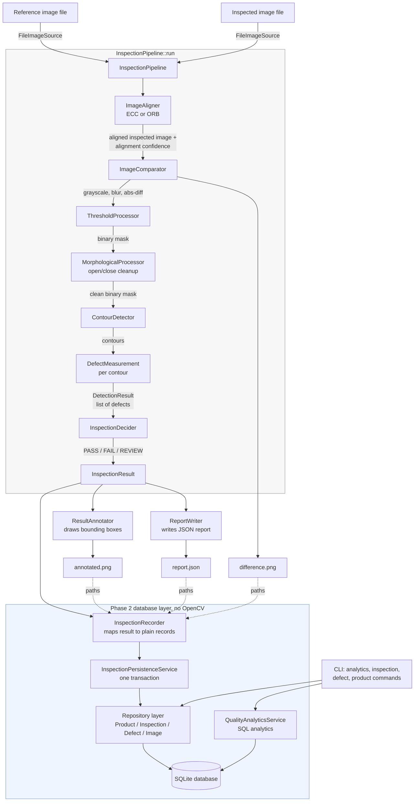
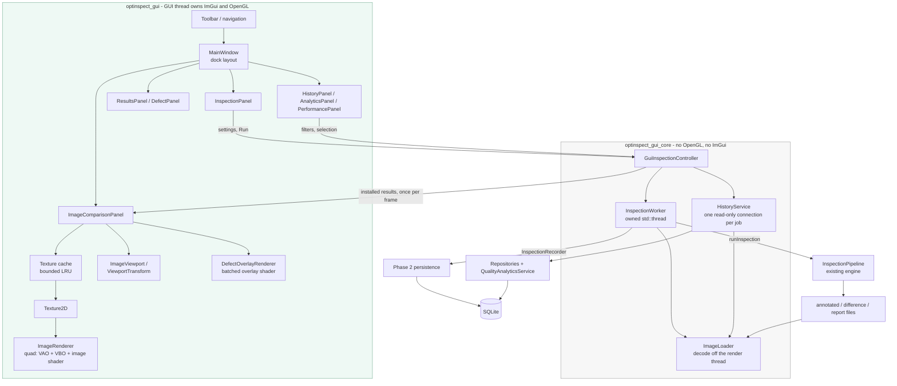

# Architecture

## Overview

OptiInspect is a batch/single-shot CLI pipeline: it loads a reference and an
inspected image, aligns them, computes a difference-based defect mask,
measures candidate defect regions, applies decision rules, and emits a
report plus annotated images. Since Phase 2 the finished `InspectionResult` can
additionally be persisted in an embedded SQLite database (inspection history,
defect measurements, image/report references) and queried for quality
analytics. Persistence is optional and strictly downstream of the engine. Phase 3 adds an interactive OpenGL desktop application (`optinspect_gui`) on top of the unchanged engine and database; there is still no service or network component.

## Module responsibilities

| Module | Responsibility |
|---|---|
| `common` | Cross-cutting utilities: exception hierarchy (`Errors.hpp`), stage timing (`Timing.hpp`), and JSON-backed configuration (`Config.hpp`/`.cpp`, including the optional `database` section). No dependency on any other module. |
| `acquisition` | Abstracts "where an image comes from" behind `ImageSource`; Phase 1 provides `FileImageSource` (loads from disk via OpenCV). Future phases could add a camera-based source without touching downstream code. |
| `processing` | Pure image-processing building blocks: grayscale/blur/diff/crop (`ImageProcessor`), alignment (`ImageAligner`, ECC or ORB), thresholding (`ThresholdProcessor`), morphology (`MorphologicalProcessor`), and `ImageComparator`, which composes these into "reference + inspected -> binary defect mask." |
| `detection` | Turns a binary mask into structured results: `ContourDetector` finds candidate regions, `DefectMeasurement` computes their geometry, `IDefectDetector`/`DefectDetector` package this into a `DetectionResult`, and `InspectionDecider` applies configurable PASS/FAIL/REVIEW rules. `InspectionResult` is the shared result type. |
| `database` (`include/database/`, `src/database/`) | Phase 2 persistence. `DatabaseConnection`/`Statement`/`Transaction` are RAII wrappers over the SQLite C API; `DatabaseInitializer` creates and versions the schema; `ProductRepository`, `InspectionRepository`, `DefectRepository` and `InspectionImageRepository` implement CRUD; `InspectionPersistenceService` stores an inspection atomically; `QualityAnalyticsService` runs the analytical SQL. Depends only on `common/Errors.hpp` and SQLite — **not** on OpenCV or the engine. See [database-design.md](database-design.md). |
| `application` (in `src/application/`, not `include/`) | CLI-facing glue: `InspectionPipeline` orchestrates align -> compare -> detect -> decide; `ResultAnnotator` draws output images; `ReportWriter` serializes JSON reports; `CliArguments`/`main.cpp` implement the executable entry point; `InspectionRecorder` maps an `InspectionResult` onto the database layer's plain records and opens the database; `DatabaseCommands` implements the `db`, `product`, `inspection`, `defect` and `analytics` subcommands. Kept out of `include/` because it is private application wiring, not a reusable library API. |
| `communication` (reserved) | Future phase: integration with external line-control systems. No implementation yet — see [communication-protocol.md](communication-protocol.md). |
| `visualization` (`include/visualization/`, `src/visualization/`, `resources/shaders/`) | Phase 3 reusable OpenGL 3.3 rendering components: `GLContext` (GLFW + GLAD), `Shader`, `Texture2D`, `ImageRenderer`, `DefectOverlayRenderer`, `GpuTimer` plus pure-logic parts (`ViewportTransform`, `ImageViewport`, `ImageFormat`, `TextureCache`). Depends on OpenCV (pixel data), GLFW and GLAD only - **not** on the inspection pipeline and **not** on the database. See [visualization-design.md](visualization-design.md). |
| `application/gui` (`src/application/gui/`) | Phase 3 GUI application layer: Dear ImGui panels (`MainWindow`, `InspectionPanel`, `ImageComparisonPanel`, `ResultsPanel`, `DefectPanel`, `HistoryPanel`, `AnalyticsPanel`, `PerformancePanel`), `NativeFileDialog` (Windows `IFileDialog`) and the window-free `optinspect_gui_core` (`GuiInspectionController`, `InspectionWorker`, `HistoryService`, `ImageLoader`). It is the only place where engine results, database records and rendering meet. |

## Build structure

- `optinspect_engine` (static lib): `common` + `acquisition` + `processing` +
  `detection` — the reusable, UI-independent inspection engine.
- `optinspect_database` (static lib): the Phase 2 database layer; links SQLite
  (`unofficial::sqlite3::sqlite3` from vcpkg) and nothing else.
- `optinspect_application` (static lib): the application layer described
  above, linked against `optinspect_engine` and `optinspect_database`.
- `optinspect` (executable): thin wrapper that links `optinspect_application`
  and calls `main()`.
- `optinspect_test_support` (static lib, tests-only): synthetic PCB-like
  image generators used so the test suite does not depend on an external
  dataset being present.
- `optinspect_unit_tests` / `optinspect_integration_tests` /
  `optinspect_database_tests`: GoogleTest executables, discovered via
  `gtest_discover_tests`. The database tests link only `optinspect_database`.
- `optinspect_database_benchmark`: manually run synthetic benchmark of the
  database layer (not a CTest test).
- **Phase 3 (only with `-DOPTINSPECT_BUILD_GUI=ON`, the default):**
  - `optinspect_visualization` (static lib): OpenGL rendering components; links OpenCV core, GLAD and GLFW.
  - `optinspect_gui_core` (static lib): GUI controller, worker, history/analytics access, image loading; links `optinspect_application` (so the engine and database) - no OpenGL, no ImGui.
  - `optinspect_gui` (executable): window, ImGui panels, file dialogs; links `optinspect_gui_core`, `optinspect_visualization` and `imgui::imgui`.
  - `optinspect_visualization_tests`, `optinspect_gui_integration_tests`, `optinspect_visualization_gl_smoke` (CTest) and `optinspect_visualization_benchmark` (manual).
  - `optinspect_engine`, `optinspect_database`, `optinspect_application` and `optinspect` do not depend on any of these and build with `-DOPTINSPECT_BUILD_GUI=OFF`.

## Data flow

### Phase 3: desktop application

Dependency direction: ``optinspect_gui`` -> ``optinspect_gui_core`` -> ``optinspect_application`` -> (``optinspect_engine``, ``optinspect_database``), and ``optinspect_gui`` -> ``optinspect_visualization``. Nothing in the engine, the database layer or ``optinspect_visualization`` includes a GUI header; the visualization library does not include a database or pipeline header either, and neither the engine nor the database links OpenGL.

Ownership and threads:

- The GUI thread owns the GL context, every texture and every ImGui call. Background jobs (inspection, history, analytics, historical image load) run on threads owned by ``AsyncTask``/``InspectionWorker`` (joined in their destructors, no detached threads), receive their input by value and return immutable results (``shared_ptr<const cv::Mat>``) that the controller installs on the GUI thread in ``update()``.
- Textures are created only on the GUI thread from the decoded images (``ImageComparisonPanel::syncTextures``) and cached by "path | modification time | size", so an unchanged file is neither decoded nor uploaded again.
- Persistence and history use the existing ``InspectionRecorder`` / repositories; every background job opens its own SQLite connection, so no connection is shared between threads.
## Key design decisions

- **Decision logic is isolated.** `InspectionDecider` has no OpenCV
  dependency and operates purely on `DetectionResult` + `DecisionConfig`,
  so PASS/FAIL/REVIEW thresholds can be tuned or unit-tested without
  touching image-processing code.
- **Alignment failure is explicit, not silent.** Both ECC and ORB alignment
  report a confidence score and an explicit success/failure flag; low
  confidence routes the overall decision to `REVIEW` rather than producing
  a potentially-wrong PASS/FAIL on a misaligned comparison.
- **Confidence is rule-based, not semantic.** `DefectMeasurement::confidence`
  reflects "how large/solid is this region" (area-based saturation), not
  "what kind of defect is this" — Phase 1 makes no claim to classify among
  the six DeepPCB defect categories.
- **Extensibility for ML.** `IDefectDetector` is a small interface
  (`detect(reference, inspected, config) -> DetectionResult`) specifically
  so a future YOLO/CNN-based detector could be substituted for
  `DefectDetector` without any change to `InspectionPipeline` or downstream
  reporting/decision code.
- **The database layer is decoupled from the engine.** The engine never
  includes a database header, and the database library never includes an
  engine or OpenCV header. The only place both meet is
  `InspectionRecorder` in the application layer, which copies the values of an
  `InspectionResult` into the database's plain `Models.hpp` records. Detection
  and decision therefore run, and are tested, without any database; with
  persistence disabled (the default) the Phase 1 workflow behaves exactly as
  before.
- **Persist after processing, never during.** The inspection finishes and its
  files are written first. A database failure is then reported (exit code 74)
  without altering or hiding the decision, and `inspection import` can store
  the result later from its JSON report.
- **Dependencies are injected.** Repositories and services take a
  `DatabaseConnection&` in their constructor; there is no global database
  state, so tests use private temporary databases.
- **No premature infrastructure.** `communication/` and `visualization/` exist
  only as documented, empty stubs — the project does not pretend to have
  external integration or a viewer it does not implement. SQLite is the only
  database engine; a client/server database is a possible future extension.
