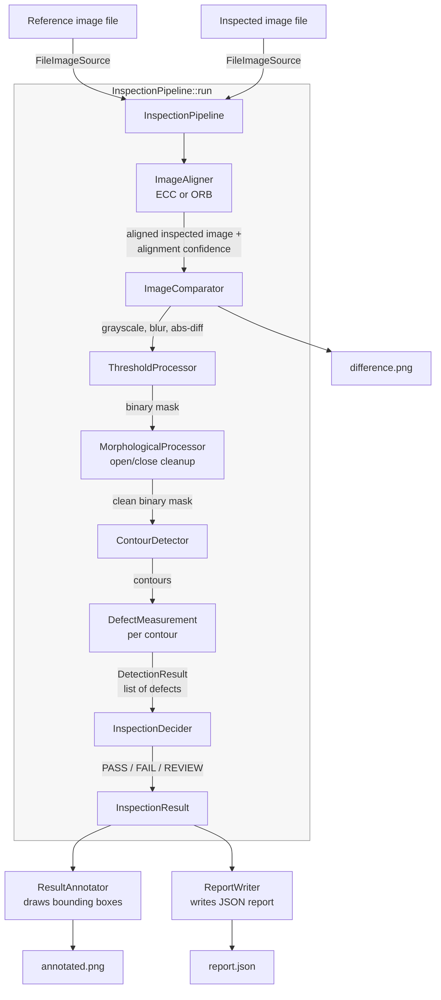

# Architecture

## Overview

OptiInspect is a batch/single-shot CLI pipeline: it loads a reference and an
inspected image, aligns them, computes a difference-based defect mask,
measures candidate defect regions, applies decision rules, and emits a
report plus annotated images. There is no persistent service, database, or
network component in Phase 1.

## Module responsibilities

| Module | Responsibility |
|---|---|
| `common` | Cross-cutting utilities: exception hierarchy (`Errors.hpp`), stage timing (`Timing.hpp`), and JSON-backed configuration (`Config.hpp`/`.cpp`). No dependency on any other module. |
| `acquisition` | Abstracts "where an image comes from" behind `ImageSource`; Phase 1 provides `FileImageSource` (loads from disk via OpenCV). Future phases could add a camera-based source without touching downstream code. |
| `processing` | Pure image-processing building blocks: grayscale/blur/diff/crop (`ImageProcessor`), alignment (`ImageAligner`, ECC or ORB), thresholding (`ThresholdProcessor`), morphology (`MorphologicalProcessor`), and `ImageComparator`, which composes these into "reference + inspected -> binary defect mask." |
| `detection` | Turns a binary mask into structured results: `ContourDetector` finds candidate regions, `DefectMeasurement` computes their geometry, `IDefectDetector`/`DefectDetector` package this into a `DetectionResult`, and `InspectionDecider` applies configurable PASS/FAIL/REVIEW rules. `InspectionResult` is the shared result type. |
| `application` (in `src/application/`, not `include/`) | CLI-facing glue: `InspectionPipeline` orchestrates align -> compare -> detect -> decide; `ResultAnnotator` draws output images; `ReportWriter` serializes JSON reports; `CliArguments`/`main.cpp` implement the executable entry point. Kept out of `include/` because it is private application wiring, not a reusable library API. |
| `database` (reserved) | Future phase: persistence of inspection history. No implementation in Phase 1 — see [database-design.md](database-design.md). |
| `communication` (reserved) | Future phase: integration with external line-control systems. No implementation in Phase 1 — see [communication-protocol.md](communication-protocol.md). |
| `visualization` (reserved) | Future phase: interactive result viewer. Phase 1's only presentation logic (`ResultAnnotator`) lives in `src/application/` instead, as a small CLI-output helper. |

## Build structure

- `optinspect_engine` (static lib): `common` + `acquisition` + `processing` +
  `detection` — the reusable, UI-independent inspection engine.
- `optinspect_application` (static lib): the application layer described
  above, linked against `optinspect_engine`.
- `optinspect` (executable): thin wrapper that links `optinspect_application`
  and calls `main()`.
- `optinspect_test_support` (static lib, tests-only): synthetic PCB-like
  image generators used so the test suite does not depend on an external
  dataset being present.
- `optinspect_unit_tests` / `optinspect_integration_tests`: GoogleTest
  executables, discovered via `gtest_discover_tests`.

## Data flow

## Key design decisions

- **Decision logic is isolated.** `InspectionDecider` has no OpenCV
  dependency and operates purely on `DetectionResult` + `DecisionConfig`,
  so PASS/FAIL/REVIEW thresholds can be tuned or unit-tested without
  touching image-processing code.
- **Alignment failure is explicit, not silent.** Both ECC and ORB alignment
  report a confidence score and an explicit success/failure flag; low
  confidence routes the overall decision to `REVIEW` rather than producing
  a potentially-wrong PASS/FAIL on a misaligned comparison.
- **Confidence is rule-based, not semantic.** `DefectMeasurement::confidence`
  reflects "how large/solid is this region" (area-based saturation), not
  "what kind of defect is this" — Phase 1 makes no claim to classify among
  the six DeepPCB defect categories.
- **Extensibility for ML.** `IDefectDetector` is a small interface
  (`detect(reference, inspected, config) -> DetectionResult`) specifically
  so a future YOLO/CNN-based detector could be substituted for
  `DefectDetector` without any change to `InspectionPipeline` or downstream
  reporting/decision code.
- **No premature infrastructure.** `database/` and `communication/` exist
  only as documented, empty stubs — Phase 1 does not pretend to have
  persistence or external integration it does not actually implement.
