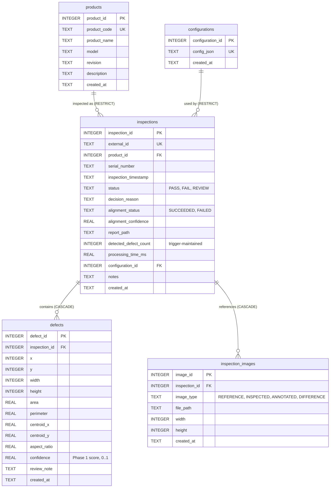

# Database Design

OptiInspect Phase 2 persists every inspection in an embedded **SQLite 3**
database. The database layer (`include/database/`, `src/database/`, library
`optinspect_database`) is independent of OpenCV and of the detection engine:
it stores plain data records handed to it by the application layer. See
[architecture.md](architecture.md) for how the pieces fit together.

SQL Server or any client/server database is **not** part of this phase.

## Entities

| Entity | Table | Meaning |
|---|---|---|
| Product | `products` | A PCB product/model (e.g. `PCB-001`, "Controller Board"). *Not* an individual board or an inspection event. |
| Configuration snapshot | `configurations` | The exact algorithm parameters used (the `configuration` block of the Phase 1 report, as JSON). Stored once and shared by every inspection that used the same parameters. |
| Inspection | `inspections` | One inspection execution: timestamp, decision (PASS/FAIL/REVIEW), alignment outcome, processing time, optional product and serial number, report path. |
| Defect | `defects` | One suspicious region measured by the Phase 1 detector (bounding box, area, perimeter, centroid, aspect ratio, score). |
| Inspection image | `inspection_images` | A *reference* (path + dimensions) to one of the images of an inspection: `REFERENCE`, `INSPECTED`, `ANNOTATED`, `DIFFERENCE`. Image bytes are never stored in SQLite. |

### Design decisions that deviate from the suggested columns

* **No `defect_type` / `severity` columns.** Phase 1 only produces
  geometric measurements of suspicious regions and a rule-based, area-derived
  score (`DefectMeasurement::confidence`, `min(1, area/2000)`); it does not
  classify defects (see [algorithms.md](algorithms.md)). Storing invented
  classes would be misleading, so the table stores the real values
  (`confidence`) instead.
* **Image paths live only in `inspection_images`.** The suggested
  `*_image_path` columns on `inspections` would duplicate that table, so they
  were left out. `report_path` stays on `inspections` (a report is not an image).
* **`configurations` is a separate table.** Storing the ~600-byte JSON in every
  inspection row would repeat it thousands of times, while a table keyed by the
  JSON text (`UNIQUE`) stores each distinct parameter set once and lets
  analytics answer "which threshold settings produced these results?" with a
  join. This is the only normalisation beyond the suggested design.
* **`external_id`** (unique, nullable) on `inspections` holds the Phase 1
  inspection id (e.g. `20261114-213626-00041000`) that names the report and
  image files. It links a database row to its files and makes importing the
  same report twice detectable.
* **`inspections.alignment_status` / `alignment_confidence`, `decision_reason`,
  `notes`** were added because Phase 1 produces them and they are needed to
  explain REVIEW results; `notes` and `defects.review_note` are the free-text
  fields an operator may edit afterwards.
* **`detected_defect_count`** is derived data kept by triggers (see below), so
  it cannot drift from the defect rows.

## ER diagram



The authoritative DDL is `src/database/Schema.cpp` (migration 1).

## Table details

Timestamps are UTC ISO-8601 text, `YYYY-MM-DDTHH:MM:SSZ`; this format sorts
chronologically as plain text and is understood by SQLite's date functions.

### `products`

| Column | Type | Constraints |
|---|---|---|
| `product_id` | INTEGER | PRIMARY KEY |
| `product_code` | TEXT | NOT NULL, UNIQUE, CHECK non-blank |
| `product_name` | TEXT | NOT NULL, CHECK non-blank |
| `model`, `revision`, `description` | TEXT | nullable |
| `created_at` | TEXT | NOT NULL |

### `configurations`

| Column | Type | Constraints |
|---|---|---|
| `configuration_id` | INTEGER | PRIMARY KEY |
| `config_json` | TEXT | NOT NULL, UNIQUE |
| `created_at` | TEXT | NOT NULL |

### `inspections`

| Column | Type | Constraints |
|---|---|---|
| `inspection_id` | INTEGER | PRIMARY KEY |
| `external_id` | TEXT | UNIQUE (nullable) |
| `product_id` | INTEGER | FK → `products`, `ON DELETE RESTRICT`, nullable (product unknown) |
| `serial_number` | TEXT | nullable |
| `inspection_timestamp` | TEXT | NOT NULL |
| `status` | TEXT | NOT NULL, CHECK IN ('PASS','FAIL','REVIEW') |
| `decision_reason` | TEXT | nullable |
| `alignment_status` | TEXT | CHECK NULL or IN ('SUCCEEDED','FAILED') |
| `alignment_confidence` | REAL | nullable |
| `report_path` | TEXT | nullable |
| `detected_defect_count` | INTEGER | NOT NULL DEFAULT 0, CHECK >= 0 (trigger-maintained) |
| `processing_time_ms` | REAL | CHECK NULL or >= 0 |
| `configuration_id` | INTEGER | FK → `configurations`, `ON DELETE RESTRICT`, nullable |
| `notes` | TEXT | nullable |
| `created_at` | TEXT | NOT NULL |

### `defects`

| Column | Type | Constraints |
|---|---|---|
| `defect_id` | INTEGER | PRIMARY KEY |
| `inspection_id` | INTEGER | NOT NULL, FK → `inspections`, `ON DELETE CASCADE` |
| `x`, `y` | INTEGER | NOT NULL |
| `width`, `height` | INTEGER | NOT NULL, CHECK >= 0 |
| `area` | REAL | NOT NULL, CHECK >= 0 |
| `perimeter`, `aspect_ratio` | REAL | CHECK NULL or >= 0 |
| `centroid_x`, `centroid_y` | REAL | nullable |
| `confidence` | REAL | CHECK NULL or between 0 and 1 |
| `review_note` | TEXT | nullable |
| `created_at` | TEXT | NOT NULL |

### `inspection_images`

| Column | Type | Constraints |
|---|---|---|
| `image_id` | INTEGER | PRIMARY KEY |
| `inspection_id` | INTEGER | NOT NULL, FK → `inspections`, `ON DELETE CASCADE` |
| `image_type` | TEXT | NOT NULL, CHECK IN ('REFERENCE','INSPECTED','ANNOTATED','DIFFERENCE') |
| `file_path` | TEXT | NOT NULL, CHECK non-empty |
| `width`, `height` | INTEGER | CHECK NULL or > 0 |
| `created_at` | TEXT | NOT NULL |
| | | UNIQUE (`inspection_id`, `image_type`) |

## Indexes

| Index | Columns | Why |
|---|---|---|
| `idx_inspections_product_time` | `(product_id, inspection_timestamp)` | Inspection history of a product, newest first, with optional date range; also the access path for per-product analytics. |
| `idx_inspections_time` | `(inspection_timestamp)` | Date-range scans and time-bucketed analytics without a product filter. |
| `idx_inspections_status_time` | `(status, inspection_timestamp)` | "All FAIL/REVIEW inspections in a period". |
| `idx_inspections_serial` | `(serial_number)` partial, `WHERE serial_number IS NOT NULL` | Traceability lookup of a board by serial number; skips the many rows without one. |
| `idx_inspections_configuration` | `(configuration_id)` | Foreign-key lookups (RESTRICT checks, joins on configuration). |
| `idx_defects_inspection` | `(inspection_id)` | Fetch the defects of an inspection; makes cascade deletes and the analytics joins index-driven. |
| `idx_defects_area` | `(area)` | Area-range filters on defects. |

Implicit indexes exist for every primary key and `UNIQUE` constraint
(`product_code`, `config_json`, `external_id`, `(inspection_id, image_type)`).
`EXPLAIN QUERY PLAN` was used (on a small database created by the CLI) to confirm
that the history queries (product + date range, status + date, serial number),
the defect lookups and the area filter are planned as index searches rather than
full scans; the planner's choice on very large tables was not separately
studied. Indexes cost write time and space, so none were added for columns that
are only ever aggregated.

## Constraints and integrity

* Foreign keys are enforced: `PRAGMA foreign_keys = ON` is issued on every
  connection (SQLite defaults to off) and verified; opening fails if SQLite
  was built without foreign-key support.
* `CHECK` constraints enumerate the legal status, alignment and image-type
  values and guard numeric ranges.
* **Immutable history** (enforced by triggers, not just by convention):
  * `defects`: every column except `review_note` is immutable.
  * `inspections`: `external_id`, `inspection_timestamp`, `status`,
    `decision_reason`, `alignment_status`, `alignment_confidence`,
    `processing_time_ms`, `configuration_id` and `created_at` are immutable.
    Mutable: `product_id`, `serial_number`, `report_path`, `notes`.
  * `products`: `product_code` is the business key and is not changed by the
    repository; name, model, revision, description are editable.
* `detected_defect_count` is maintained by `AFTER INSERT/DELETE` triggers on
  `defects`.

## Deletion policy

| Operation | Behaviour |
|---|---|
| Delete a product with inspections | **Refused** (`ON DELETE RESTRICT`, reported as `ConstraintViolationError` / exit code 74). Inspection history is never deleted silently. A product without inspections can be deleted. |
| Delete an inspection | Allowed. In one transaction its `defects` and `inspection_images` rows are removed (`ON DELETE CASCADE`). The shared `configurations` row remains. |
| Delete a single defect | Allowed; the inspection's `detected_defect_count` is decremented by a trigger. |
| Delete an image reference | Removes the database row only. |
| **Files on disk** | **Never** deleted by any database operation: not the images, not the report. |

## Schema versioning and migrations

The schema version is stored in SQLite's `PRAGMA user_version`
(`0` = not initialised). `DatabaseInitializer::initialize()`:

1. checks that the linked SQLite is 3.25 or newer (window functions);
2. refuses a database whose version is **newer** than this build knows;
3. refuses a database with `user_version = 0` that already contains tables
   (somebody else's database is never modified);
4. enables WAL journaling for file databases (readers such as analytics can run
   while an inspection is being written);
5. applies every migration with a higher version than the current one, **each in
   its own transaction together with the `user_version` bump**, so a failed
   migration leaves the previous version intact.

Running it again on an up-to-date database changes nothing, and it never drops
or recreates tables or data.

**Introducing a schema change:** append a new `Migration{N+1, description, sql}`
to `migrations()` in `src/database/Schema.cpp`. Never edit a migration that has
shipped. Use additive DDL (`ALTER TABLE ... ADD COLUMN`, new tables/indexes) or
the standard create-copy-rename sequence for anything SQLite cannot alter in
place, add a test that migrates a version-N database to N+1 without losing data,
and update this document. Commands other than `db init` refuse to run on a
database whose version differs from the one the build expects and tell the user
to run `optinspect db init`. (Only version 1 exists today, so the upgrade path
has not yet been exercised by a real second migration.)

## Transaction strategy

* `Transaction` (`DatabaseTransaction.hpp`) is RAII: it rolls back on
  destruction unless `commit()` was called. The outermost one issues
  `BEGIN IMMEDIATE` (lock conflicts surface at the start); nested ones use
  `SAVEPOINT`, so repository methods that open their own transaction can be
  called inside a larger one.
* `InspectionPersistenceService::persist()` writes the inspection, its
  configuration snapshot, all defects and all image references in **one
  transaction**: either everything is stored or nothing is.
  `DefectRepository::createMany()` and `InspectionRepository::create()` /
  `remove()` are atomic on their own.
* All SQL with parameters uses prepared statements and named bind parameters
  (`Statement`); no user value is ever concatenated into SQL text. The only
  dynamically assembled SQL consists of fixed fragments chosen from the set of
  supplied filters (`WHERE` clauses, `GROUP BY` period expressions).
* A busy timeout of 5 s makes a concurrent writer wait instead of failing
  immediately.

## Database initialisation

```powershell
optinspect.exe db init --database data/optinspect.db   # creates directory, file and schema
optinspect.exe db info --database data/optinspect.db   # version, journal mode, row counts
```

`inspect --database <path>` initialises the database automatically when
`database.auto_initialize` is `true` (default). The database path is
configurable (`--database`, or `database.path` in `config/inspection_config.json`);
runtime databases are git-ignored and must not be stored in source directories.

## Data traceability

An inspection row links, through foreign keys and stored paths, everything that
produced and resulted from it:

```
products - inspections -+- configurations    (parameters used, as JSON)
                        +- defects           (every measured region)
                        +- inspection_images (REFERENCE, INSPECTED, ANNOTATED, DIFFERENCE paths + size)
                        +- report_path       (the <id>_report.json) and external_id (the Phase 1 id)
```

Paths are stored absolute so they stay valid whichever directory the tool is
started from. If a file is moved, correct the reference with
`inspection update --report-path` or the image repository's `update()`.

### If persistence fails

Persistence runs after the pipeline, so a database failure never changes the
inspection result. The CLI prints the failure, keeps all generated files, exits
with code **74**, and prints the command that stores the inspection later from
its JSON report:

```powershell
optinspect.exe inspection import --report results\20261114-213626_report.json --database data/optinspect.db
```

Importing the same report twice is detected through `external_id` and is a no-op.
An import reconstructs the stored values from the report (the decision, defects,
configuration and image paths); the processing time is the sum of the stage
timings recorded in the report rather than the wall-clock total, and the
timestamp is taken from the inspection id.

## Analytics

All indicators are computed by SQL in `QualityAnalyticsService` and can be
narrowed by product, serial number, status and date range. Rates use all
inspections in scope (PASS + FAIL + REVIEW) as the denominator and are 0 when
there are none.

| Indicator | Technique |
|---|---|
| Inspection summary: counts and PASS/FAIL/REVIEW rates | aggregate + `CASE` for zero-safe division |
| Defect statistics: total, average per inspection, maximum, average area | CTE + `LEFT JOIN` (zero-defect inspections count in the average) |
| Defects by Phase 1 score band (LOW < 0.33, MEDIUM < 0.66, HIGH) | `CASE` + `GROUP BY` — a reporting bucket over the area-based score, **not** a defect class |
| Product quality: inspections, failures, failure rate, average time | `LEFT JOIN`, `GROUP BY`, `HAVING` (minimum sample size), `ORDER BY` |
| Inspections per day/week/month, failure rate and defect trend over time | CTE + window functions `SUM() OVER` (running total) and `LAG()` (period-over-period change) |
| Processing time: average/min/max overall, by status, by product | aggregates over non-NULL times only |
| Inspection history filters | `InspectionRepository::list()` (date range, product, serial, status, paging) |

Weeks are SQLite `%W` weeks (Monday-first, week 00 before the first Monday).

**What the analytics are not:** these are production-quality indicators over
detector *output*. They do not say whether a region is a true or false
positive — that needs ground-truth annotations and a separate detector
validation step, which is out of scope here. For the same reason no
"false positive/negative" metric exists.

### Example queries

Failure rate per product (the core of `analytics products`):

```sql
SELECT COALESCE(p.product_code, '(unassigned)') AS product,
       COUNT(*)                                 AS total,
       SUM(i.status = 'FAIL')                   AS failed,
       1.0 * SUM(i.status = 'FAIL') / COUNT(*)  AS failure_rate,
       AVG(i.processing_time_ms)                AS avg_ms
FROM inspections i
LEFT JOIN products p ON p.product_id = i.product_id
GROUP BY i.product_id
HAVING COUNT(*) >= 5
ORDER BY failure_rate DESC, total DESC;
```

Daily trend with a running total and the change in defects per inspection
(`analytics trend --period day`):

```sql
WITH per_day AS (
    SELECT substr(inspection_timestamp, 1, 10) AS day,
           COUNT(*) AS total,
           SUM(status = 'FAIL') AS fails,
           SUM(detected_defect_count) AS defects
    FROM inspections
    GROUP BY day)
SELECT day, total, fails,
       SUM(total) OVER (ORDER BY day)                         AS cumulative,
       1.0 * defects / total
         - LAG(1.0 * defects / total) OVER (ORDER BY day)     AS defects_per_inspection_change
FROM per_day
ORDER BY day;
```

Trace a board and everything stored for it:

```sql
SELECT i.inspection_id, i.inspection_timestamp, i.status, i.report_path,
       img.image_type, img.file_path
FROM inspections i
JOIN inspection_images img ON img.inspection_id = i.inspection_id
WHERE i.serial_number = 'SN-0001'
ORDER BY i.inspection_timestamp DESC, img.image_id;
```

Which parameter sets produced the most FAIL results:

```sql
SELECT c.configuration_id, COUNT(*) AS inspections,
       1.0 * SUM(i.status = 'FAIL') / COUNT(*) AS fail_rate
FROM inspections i JOIN configurations c USING (configuration_id)
GROUP BY c.configuration_id ORDER BY fail_rate DESC;
```
